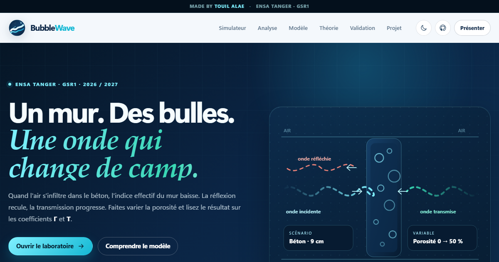

# BubbleWave

**Propagation d'ondes électromagnétiques dans un mur en béton à bulles.**

**Auteur : Touil Alae** — ENSA Tanger, filière GSR1, 2026 / 2027.

Un simulateur pédagogique interactif : un mur de béton sec de **9,0 cm**, des bulles d'air dont on fait varier la **porosité**, et une onde plane qui arrive dessus à une fréquence, un angle et une polarisation réglables.

Le site calcule en temps réel les coefficients de réflexion **R**, de transmission **T** et d'absorption **A**, trace les courbes associées et montre le champ électrique à l'intérieur de la paroi.

**Site en ligne :** <https://alae35846.github.io/BubbleWave/>  
**Dépôt :** <https://github.com/alae35846/BubbleWave>



## Ce que montre le projet

- L'effet de la porosité sur la permittivité effective du béton.
- Les coefficients complexes **Γ** (réflexion) et **τ** (transmission), puis les grandeurs d'énergie **R = |Γ|²**, **T = |τ|²** et **A = 1 − R − T**.
- L'influence de la fréquence (0,5 → 6 GHz), de l'angle (0 → 80°) et de la polarisation **TE / TM**.
- Le profil du champ **|E(z)| / |E_i|** dans l'air et dans le mur, avec les interférences internes.
- Une validation numérique à chaque calcul : bilan d'énergie, comparaison TMM / formule d'Airy, limites de Maxwell-Garnett.

Scénario fixe : béton sec (`ε′ = 6,00`, `tan δ = 0,03`), épaisseur `9,0 cm`, bulles d'air de rayon `0,5 mm`, air de part et d'autre.

## Modèle physique

1. **Milieu effectif — Maxwell-Garnett.** Les bulles sont petites devant la longueur d'onde et réparties aléatoirement. Le béton à bulles est remplacé par un milieu homogène de permittivité complexe `ε_eff`.
2. **Propagation dans la lame.** Les nombres d'onde et les admittances sont calculés pour chaque polarisation, en tenant compte de l'angle d'incidence et des pertes diélectriques.
3. **Matrice de transfert.** La lame est traitée avec ses deux interfaces et ses réflexions internes, ce qui donne **Γ** et **τ**. La formule d'Airy sert de contrôle indépendant en incidence normale.
4. **Champ et énergie.** Le profil `|E(z)|` est reconstruit dans les trois régions. Le bilan `R + T + A = 1` est vérifié numériquement.

Les relations et les hypothèses sont détaillées directement dans la section **Théorie** du site, avec les chapitres du cours de propagation :

- milieux parfaits et équations de Maxwell ;
- milieux dissipatifs, permittivité complexe et atténuation ;
- ondes stationnaires, impédance, TOS / ROS ;
- anisotropic et milieux effectifs.

## Utiliser le site

Le site est **statique** : HTML, CSS et JavaScript natifs, sans framework ni étape de compilation.

```bash
npm install
npm run dev
# → http://127.0.0.1:4173/
```

`npm install` ne télécharge aucune dépendance : le projet n'en a pas. Le serveur local est fourni par `scripts/serve.mjs`.

### Tests

```bash
npm test
```

Les tests vérifient les valeurs de référence, les limites de Maxwell-Garnett, la conservation de l'énergie sur les balayages, l'équivalence TMM / Airy, l'angle de Brewster et le profil de champ.

## Structure

```text
.
├── site/                      # site publié sur GitHub Pages
│   ├── index.html             # interface, théorie, validation, à propos
│   ├── assets/
│   │   ├── css/styles.css
│   │   ├── img/logo.svg
│   │   └── js/
│   │       ├── app.js         # interface, événements, exports
│   │       ├── charts.js      # moteur de graphiques canvas
│   │       ├── config.js      # scénario, plages, presets, métadonnées
│   │       └── physics.js     # Maxwell-Garnett, TMM, champ, validation
│   ├── manifest.webmanifest
│   └── .nojekyll
├── tests/physics.test.mjs
├── scripts/serve.mjs
└── .github/workflows/pages.yml
```

## Déploiement

Le workflow GitHub Actions `.github/workflows/pages.yml` publie automatiquement le dossier `site/` à chaque push sur `main`.

Pour l'activer une première fois sur GitHub :

1. **Settings → Pages** ;
2. **Build and deployment → Source** : choisir **GitHub Actions** ;
3. pousser sur `main`, ou lancer le workflow manuellement depuis l'onglet **Actions**.

L'URL du site sera alors : `https://<compte>.github.io/BubbleWave/`.

## Fonctionnalités de l'interface

- Curseurs de porosité, fréquence et angle, presets de porosité, choix TE / TM.
- Animation de la coupe air / mur / air : ondes incidente, réfléchie, réfractée et transmise.
- Graphiques interactifs : R/T vs porosité, fréquence, angle, et profil du champ.
- Thème clair / sombre, mode présentation, partage par URL, export CSV et PNG.
- Mise en page responsive, navigation clavier, texte alternatif et préférences de mouvement réduit.

## Hypothèses et limites

Le modèle est volontairement pédagogique. Il suppose un mur homogène, isotrope, infini latéralement, à faces planes et parallèles ; des bulles sphériques, non conductrices, petites devant λ et sans interaction entre elles. La diffusion par les bulles, la rugosité de surface et les armatures du béton sont négligées. Maxwell-Garnett devient approximatif au-delà de 50 % de porosité.

Ce simulateur ne constitue pas un outil de dimensionnement ou de certification.

---

Projet pédagogique de **Touil Alae** — ENSA Tanger, filière GSR1, 2026 / 2027.
